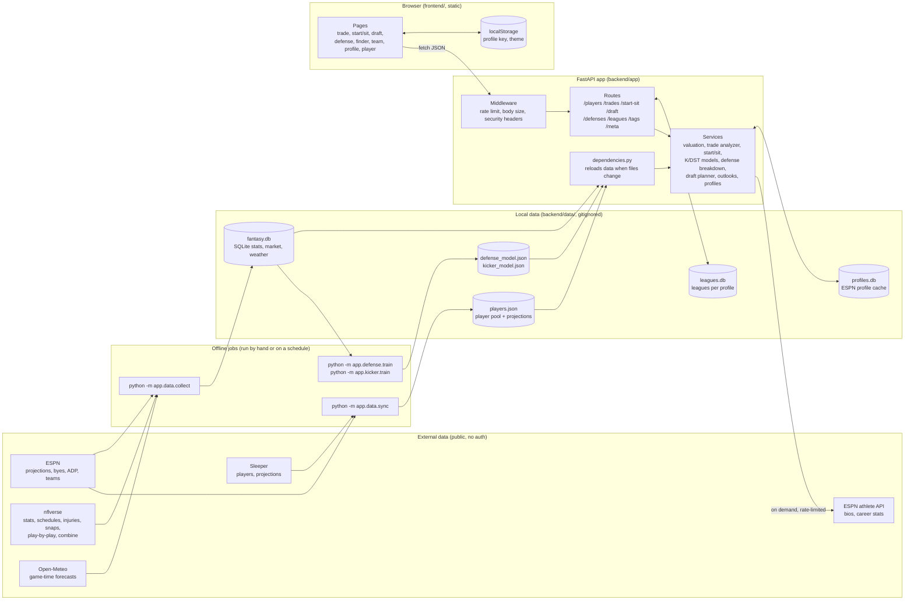

# Fantasy Cheat Code

Fantasy football tools built on free public data from Sleeper, ESPN, and nflverse.

| Tool | Page | What it does |
|---|---|---|
| Trade analyzer | `/` | Values each side of a trade over replacement, adjusted for schedule, recent form, and injuries; explains why each side wins or loses and breaks down every player's strengths and concerns |
| Player finder | `/finder/` | Finds players by tag: slot or outside receiver, deep threat, high target share, red-zone target, workhorse or goal-line back, hot streak, rookie, and more |
| Start/sit | `/start-sit/` | Picks who to start in a week with a confidence level and reasons, or sets the best lineup for any of your leagues |
| Draft masterclass | `/draft/` | Lays out your snake-draft picks and who's likely available at each, warns when a position's best tier is about to run dry, and follows an ESPN draft live as picks are made |
| Defense breakdown | `/defense/` | Ranks each defense's line, linebackers, corners, and safeties against the league, with unit results, fantasy points allowed by position, and upcoming DST projections |
| My team | `/team/` | Saves your roster and lineup spots for each league |
| Profile | `/profile/` | Holds your leagues (up to 10): add, rename, remove, and move them to another device |
| Player profiles | `/player/?id=…` | Bio, NFL and college stats, and combine results |
| Tier lists | `/tiers/` | Groups each position (or flex) into tiers where projected points drop sharply, for this week or the rest of the season |

## Architecture



The sync and collect jobs are the only things that call Sleeper, ESPN, nflverse, or Open-Meteo in
bulk. The train jobs fit the kicker and DST matchup models from the collected history. API
requests read the local files, which reload when they change, so a fresh sync shows up without
a restart. The one exception is player profiles: they're fetched from ESPN on demand, cached,
and rate limited in both directions. All outbound requests go through one rate-limited client
(`app/data/sources/http.py`). The same FastAPI process serves the static frontend.

```
backend/
  app/
    main.py        app, middleware, router registration, static site
    config.py      settings from environment variables
    api/           routes, dependency wiring, errors, rate limiting, security headers
    services/      valuation, trades, start/sit, draft, defense breakdown, matchups, outlooks, profiles
    data/          sync and collect jobs, repositories, caches, sources/ (Sleeper, ESPN, nflverse, weather)
    defense/       DST features, scoring, ridge model, and training
    kicker/        kicker features and training (shares the DST model code)
    models/        Pydantic request and response models
  tests/           unit, API, property, stress, fuzz, and e2e/ browser tests
frontend/          static HTML, CSS, and JS, one folder per page
```

## Getting started

From `backend/`:

```
python -m venv .venv
.venv/Scripts/activate          # macOS/Linux: source .venv/bin/activate
pip install -r requirements.txt

python -m app.data.sync         # player pool and projections (about 15 seconds)
python -m app.data.collect      # stats, schedules, injuries, ADP (about 10 seconds, optional)

# Optional: history for the defense breakdown and the kicker/DST matchup models used by
# start/sit. The models train on every collected season after the first; more seasons
# give them more history (2018-2026 takes a few minutes).
python -m app.data.collect --seasons 2018-2026
python -m app.defense.train
python -m app.kicker.train

uvicorn app.main:app --reload
```

Open http://localhost:8000 for the site and http://localhost:8000/docs for the interactive API
docs. Without a sync the API uses fictional sample players; without a collect, values use
provider projections only (no schedule, form, or ADP), and the defense breakdown page
says its stats aren't available yet.

## API

| Endpoint | Purpose |
|---|---|
| `GET /health` | Liveness check |
| `GET /meta` | Data source (`synced` or `sample`), season, synced weeks, scoring, current week, and whether the sync is from an earlier week (`synced_week`, `stale`) |
| `GET /players?position=RB`, `GET /players/{id}` | Player pool |
| `GET /players/{id}/profile` | Bio, career and college stats, combine |
| `GET /tags`, `GET /tags?player={id}` | Player tags (slot receiver, workhorse back, hot streak, ...) with what earns each and who has them |
| `POST /trades/analyze` | Trade values for both sides (FLEX and SUPERFLEX spots count) |
| `GET /start-sit?player=7564&player=6794&week=11` | Who to start, with confidence and reasons |
| `POST /start-sit/lineup` | Best lineup from a roster for a week |
| `GET /tiers?position=RB&horizon=week` | Players at a position (or FLEX) grouped into tiers |
| `GET /draft/plan?teams=12&slot=5&rounds=15` | Your picks and likely targets at each |
| `POST /draft/live`, `GET /draft/live/{session}/events` | Follow an ESPN league's draft live (Server-Sent Events) |
| `GET /defenses?season=2026` | Every defense with position-group ranks, points allowed, and DST points per game |
| `GET /defenses/{team}` | One defense by position group and unit, with league ranks, fantasy points allowed, and next games' DST projections |
| `GET /leagues`, `POST /leagues` | The leagues on a profile (`X-Profile-Key` header), and adding one |
| `GET /leagues/{id}`, `PUT /leagues/{id}`, `DELETE /leagues/{id}` | One league: read, save (send `If-Match` with its `version` to refuse overwriting a newer save: `409 league_conflict`), remove |

Example trade:

```json
{
  "side_a": {"player_ids": ["te2"]},
  "side_b": {"player_ids": ["rb1"]},
  "league": {"num_teams": 12, "roster_slots": {"QB": 1, "RB": 2, "WR": 2, "TE": 1, "FLEX": 1, "SUPERFLEX": 1}}
}
```

`league.scoring` is optional: projections are synced for one scoring format, so a different
one is refused (`422 scoring_unavailable`) rather than silently valued in the synced format.

Errors are always `{"detail": "...", "code": "..."}`.

## Testing

```
pip install -r requirements-dev.txt
pytest                  # everything, about a minute
pytest -m "not e2e"     # skip the browser tests
pytest -m realdata      # check the data and DST model against real NFL history (needs 2018-2026 collected)
ruff check .            # lint (errors and security rules, see ruff.toml)
```

No test contacts an outside provider.

## Safety checks (CI)

Every pull request and push to `main` runs five checks in GitHub Actions
(`.github/workflows/ci.yml`):

| Check | What it stops |
|---|---|
| Guard (`scripts/guard.py`) | Secrets (private keys, API tokens, hardcoded passwords), `.env`/key/database files, `backend/data/`, files over 1 MB, merge-conflict markers, leftover debuggers, and AI attribution in commit messages |
| Secret scan (gitleaks) | Secrets anywhere in the pushed commits, with gitleaks' full rule set |
| Lint (ruff, `node --check`) | Python errors (undefined names, unused imports), security issues (bandit rules), and JavaScript that doesn't parse |
| Tests | The full suite, browser tests included |
| Dependency audit (pip-audit) | Dependencies with known vulnerabilities |

Dependabot opens weekly PRs for outdated pip packages and Actions.

The same guard runs locally before you commit and push. Turn the hooks on once per clone:

```
git config core.hooksPath .githooks
```

`pre-commit` checks what's staged; `pre-push` checks every commit being pushed and runs ruff.
A line that trips the guard on purpose can end with `guard: allow`. `--no-verify` skips the
hooks, but CI still runs.

To make the checks binding, protect `main` on GitHub (Settings > Branches): require a pull
request and require the five CI checks to pass before merging.

## More detail

[`backend/README.md`](backend/README.md) covers data sources and the database schema, how trade
values and start/sit calls are calculated, the draft guide, error codes, rate limits, security
headers, profile caching, the kicker and DST models with their backtests, the defense
breakdown, and the test suite.

## Next steps

- Lineup impact in the trade analyzer: the optimal starting lineup before and after the trade, using `roster_ids`.
- Draft guide that accounts for your roster so far.
