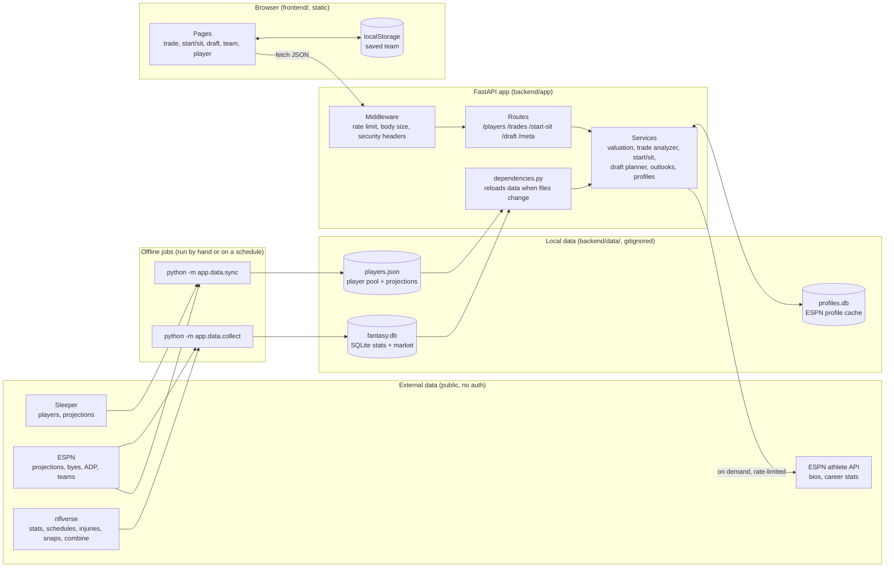

# Fantasy Cheat Code

Fantasy football tools built on free public data from Sleeper, ESPN, and nflverse.

| Tool | Page | What it does |
|---|---|---|
| Trade analyzer | `/` | Values each side of a trade over replacement, adjusted for schedule, recent form, and injuries |
| Start/sit | `/start-sit/` | Picks who to start in a week with a confidence level and reasons, or sets your saved team's best lineup |
| Draft masterclass | `/draft/` | Lays out your snake-draft picks and who's likely available at each |
| My team | `/team/` | Saves your roster and lineup spots in the browser |
| Player profiles | `/player/?id=…` | Bio, NFL and college stats, and combine results |
| Tier lists | `/tiers/` | In development |

## Architecture



The sync and collect jobs are the only things that call Sleeper, ESPN, or nflverse in bulk. API
requests read the local files, which reload when they change, so a fresh sync shows up without
a restart. The one exception is player profiles: they're fetched from ESPN on demand, cached,
and rate limited in both directions. All outbound requests go through one rate-limited client
(`app/data/sources/http.py`). The same FastAPI process serves the static frontend.

```
backend/
  app/
    main.py        app, middleware, router registration, static site
    config.py      settings from environment variables
    api/           routes, dependency wiring, errors, rate limiting, security headers
    services/      valuation, trades, start/sit, draft, matchups, outlooks, profiles
    data/          sync and collect jobs, repositories, caches, sources/ (Sleeper, ESPN, nflverse)
    models/        Pydantic request and response models
  tests/           unit, API, property, stress, fuzz, and e2e/ browser tests
frontend/          static HTML, CSS, and JS, one folder per page
```

## Getting started

From `backend/`:

```
python -m venv .venv
.venv/Scripts/activate          # macOS/Linux: source .venv/bin/activate
pip install -r requirements.txt

python -m app.data.sync         # player pool and projections (about 15 seconds)
python -m app.data.collect      # stats, schedules, injuries, ADP (about 10 seconds, optional)

uvicorn app.main:app --reload
```

Open http://localhost:8000 for the site and http://localhost:8000/docs for the interactive API
docs. Without a sync the API uses fictional sample players; without a collect, values use
provider projections only (no schedule, form, or ADP).

## API

| Endpoint | Purpose |
|---|---|
| `GET /health` | Liveness check |
| `GET /meta` | Season, synced weeks, scoring, current week |
| `GET /players?position=RB`, `GET /players/{id}` | Player pool |
| `GET /players/{id}/profile` | Bio, career and college stats, combine |
| `POST /trades/analyze` | Trade values for both sides |
| `GET /start-sit?player=7564&player=6794&week=11` | Who to start, with confidence and reasons |
| `POST /start-sit/lineup` | Best lineup from a roster for a week |
| `GET /draft/plan?teams=12&slot=5&rounds=15` | Your picks and likely targets at each |

Example trade:

```json
{
  "side_a": {"player_ids": ["te2"]},
  "side_b": {"player_ids": ["rb1"]},
  "league": {"scoring": "ppr", "num_teams": 12}
}
```

Errors are always `{"detail": "...", "code": "..."}`.

## Testing

```
pip install -r requirements-dev.txt
pytest                  # everything, about 30 seconds
pytest -m "not e2e"     # skip the browser tests
```

No test contacts an outside provider.

## More detail

[`backend/README.md`](backend/README.md) covers data sources and the database schema, how trade
values and start/sit calls are calculated, the draft guide, error codes, rate limits, security
headers, profile caching, and the test suite.

## Next steps

- Tier lists page.
- Lineup impact in the trade analyzer (`TradeAnalyzer._lineup_impact`, optimal lineup before and after).
- Draft guide that accounts for your roster so far, tiers, and positional runs.
